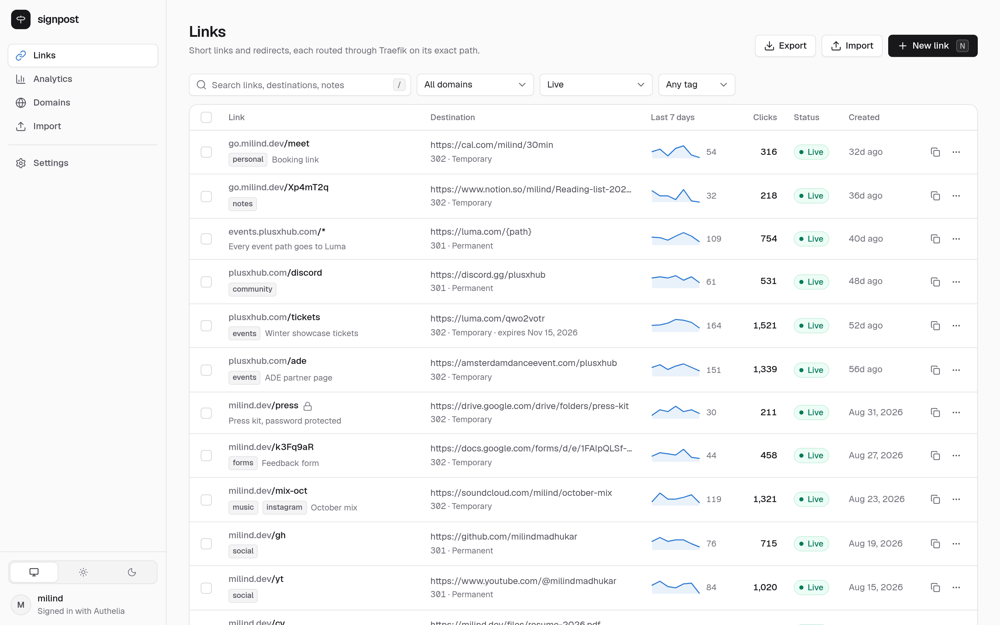
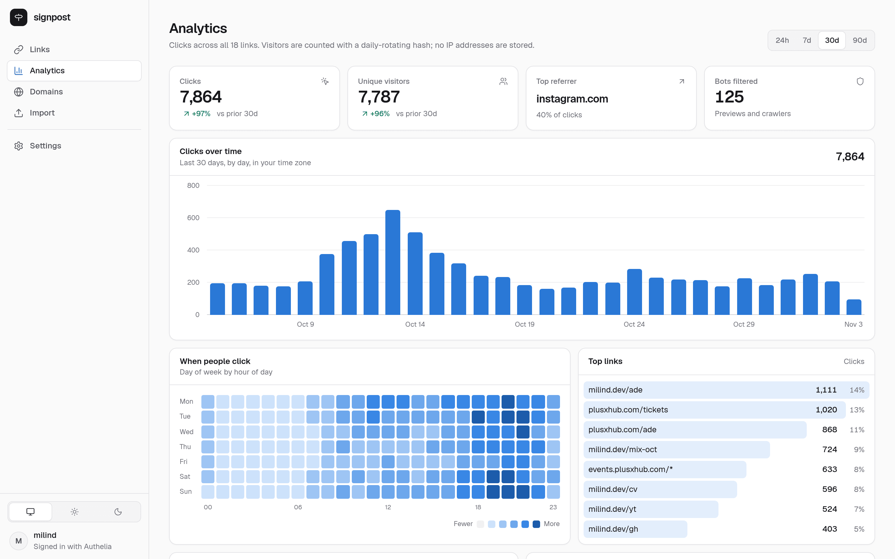
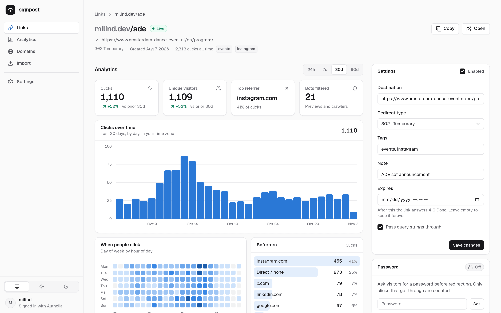
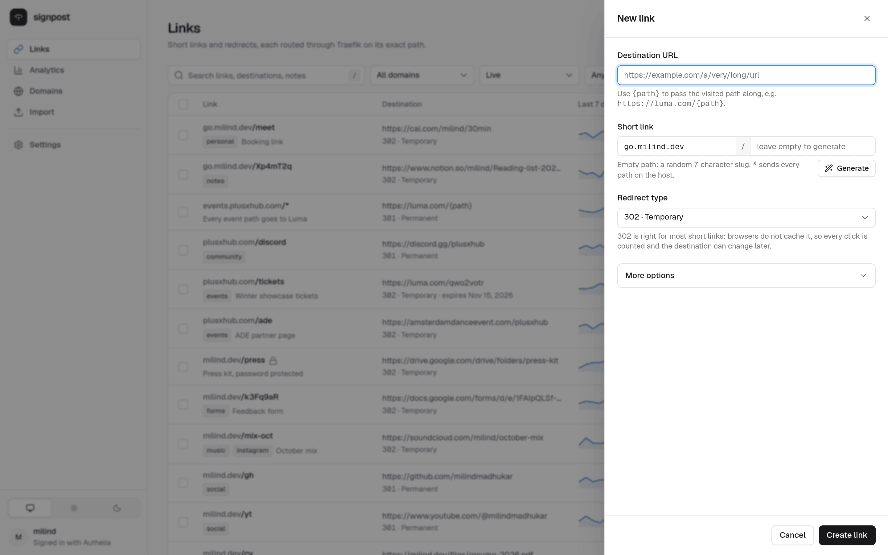
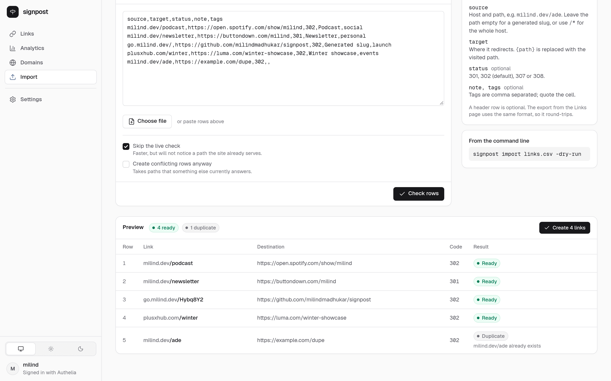
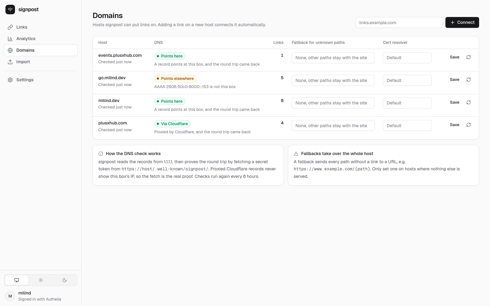
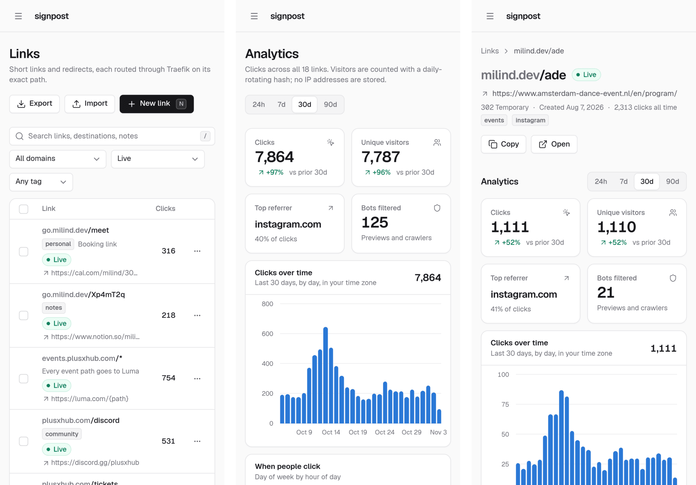
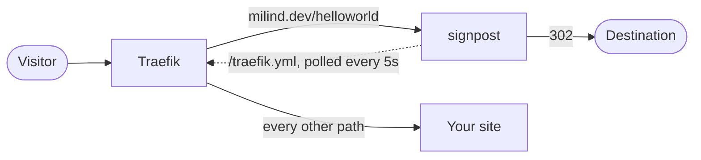

<div align="center">


# signpost

**Blazing-fast short links for any domain that already sits behind Traefik.**

Keep your site where it is. Put a link on one exact path, and only that path is routed to signpost.

[](https://github.com/milindmadhukar/signpost/actions/workflows/docker-publish.yml)


[Self-hosting](docs/self-hosting.md) &nbsp;·&nbsp;
[Configuration](docs/configuration.md) &nbsp;·&nbsp;
[CLI and API](docs/cli-and-api.md) &nbsp;·&nbsp;
[How it works](docs/how-it-works.md)

</div>

<br>

<picture>
  <source media="(prefers-color-scheme: dark)" srcset="docs/screenshots/links-dark.png">
  
</picture>

<br>

```console
$ signpost add milind.dev/helloworld https://instagram.com/p/xyz
https://milind.dev/helloworld -> https://instagram.com/p/xyz (302)
```

`milind.dev` keeps serving the portfolio. Only `/helloworld` goes to signpost.

> [!NOTE]
> signpost is **self-hosted only**. There is no hosted service and no account
> to sign up for: you run one container next to your own Traefik, and your
> links, clicks and visitors never leave your server.

## Why signpost

Most link shorteners want a domain of their own. signpost borrows paths on
the domains you already have, through the reverse proxy you already run.

- **Exact-path routing.** Each link becomes a Traefik router for one host and
  one path. Everything else on that host is untouched and never reaches
  signpost.
- **Safe by default.** Before it claims a path, signpost fetches it from the
  live internet and refuses if anything already answers, so `/about` can never
  be shadowed by accident. It then keeps probing until the new link answers
  publicly.
- **Fast where it counts.** Redirects are served from an in-memory table with
  no database read and no lock. About 3 microseconds of work per redirect, and
  30,000 redirects a second on a laptop. [See the numbers.](#performance)
- **One small binary.** Go, SQLite, server-rendered HTML. A 15 MB static
  binary in a `FROM scratch` image, one database file, no Node, no CDN, no
  external services.
- **Analytics without tracking.** Clicks, unique visitors, referrers,
  countries, devices and a weekday-by-hour heatmap. No IP address is ever
  stored, and link previews and crawlers are filtered out.

## Screenshots

<table>
  <tr>
    <td width="50%">
      <picture>
        <source media="(prefers-color-scheme: dark)" srcset="docs/screenshots/analytics-dark.png">
        
      </picture>
      <p align="center"><b>Analytics</b><br><sub>Clicks against the previous period, a heatmap in your time zone, and top links</sub></p>
    </td>
    <td width="50%">
      <picture>
        <source media="(prefers-color-scheme: dark)" srcset="docs/screenshots/link-dark.png">
        
      </picture>
      <p align="center"><b>A page per link</b><br><sub>Its own stats, settings, expiry and password in one place</sub></p>
    </td>
  </tr>
  <tr>
    <td width="50%">
      <picture>
        <source media="(prefers-color-scheme: dark)" srcset="docs/screenshots/new-link-dark.png">
        
      </picture>
      <p align="center"><b>New link</b><br><sub>Press <kbd>N</kbd> anywhere. Leave the path empty for a generated slug</sub></p>
    </td>
    <td width="50%">
      <picture>
        <source media="(prefers-color-scheme: dark)" srcset="docs/screenshots/import-dark.png">
        
      </picture>
      <p align="center"><b>Bulk import</b><br><sub>Every row is checked first; nothing is created until you confirm</sub></p>
    </td>
  </tr>
  <tr>
    <td width="50%">
      <picture>
        <source media="(prefers-color-scheme: dark)" srcset="docs/screenshots/domains-dark.png">
        
      </picture>
      <p align="center"><b>Domains</b><br><sub>DNS checks that prove the round trip, even behind Cloudflare</sub></p>
    </td>
    <td width="50%">
      <picture>
        <source media="(prefers-color-scheme: dark)" srcset="docs/screenshots/mobile-dark.png">
        
      </picture>
      <p align="center"><b>On your phone</b><br><sub>The whole dashboard fits a 390 px screen</sub></p>
    </td>
  </tr>
</table>

<sub>Screenshots follow your GitHub theme. The dashboard has light, dark and system themes.</sub>

## Quick start

You need Docker and a Traefik v3 that already serves your domains with TLS.
The full walkthrough, including authentication, is in
[docs/self-hosting.md](docs/self-hosting.md).

**1. Run signpost** on the same Docker network as Traefik (called `proxy`
here). The redirects themselves need no labels; step 2 takes care of them.

```yaml
services:
  signpost:
    image: ghcr.io/milindmadhukar/signpost:latest
    restart: always
    environment:
      - SIGNPOST_TOKEN=${SIGNPOST_TOKEN}          # for the CLI and API
      - SIGNPOST_ADMIN_HOST=links.example.com     # where the dashboard lives
      - SIGNPOST_TRUST_REMOTE_USER=true           # the dashboard sits behind forward auth
      - SIGNPOST_CERT_RESOLVER=letsencrypt        # your Traefik cert resolver
    volumes:
      - data:/data
    labels:
      - traefik.enable=true
      - traefik.docker.network=proxy
      - traefik.http.services.signpost-admin.loadbalancer.server.port=8081
      # Dashboard, behind your forward-auth middleware (Authelia, Authentik...).
      - traefik.http.routers.signpost.rule=Host(`links.example.com`)
      - traefik.http.routers.signpost.entrypoints=websecure
      - traefik.http.routers.signpost.tls.certresolver=letsencrypt
      - traefik.http.routers.signpost.middlewares=authelia@docker
      - traefik.http.routers.signpost.service=signpost-admin
      # API for the CLI: skips forward auth only when a bearer token is sent,
      # and signpost checks that token itself.
      - traefik.http.routers.signpost-api.rule=Host(`links.example.com`) && PathPrefix(`/api`) && HeaderRegexp(`Authorization`, `^Bearer .+`)
      - traefik.http.routers.signpost-api.priority=100
      - traefik.http.routers.signpost-api.entrypoints=websecure
      - traefik.http.routers.signpost-api.tls.certresolver=letsencrypt
      - traefik.http.routers.signpost-api.service=signpost-admin
    networks: [proxy]

volumes:
  data:

networks:
  proxy:
    external: true
```

**2. Point Traefik at signpost's routes**, once, with two flags on the
Traefik container:

```yaml
- "--providers.http.endpoint=http://signpost:8081/traefik.yml"
- "--providers.http.pollInterval=5s"
```

**3. Add a link.** Open `https://links.example.com` and press <kbd>N</kbd>,
or use the CLI:

```console
$ export SIGNPOST_URL=https://links.example.com SIGNPOST_TOKEN=...
$ signpost add example.com/launch https://example.org/a/very/long/url
https://example.com/launch -> https://example.org/a/very/long/url (302)
```

Within about five seconds Traefik picks up the route, and signpost marks the
link **Live** once it answers on the public internet.

## How it works

signpost keeps links in SQLite and turns each one into a Traefik router that
matches one exact host and path:

```yaml
signpost-link-1:
  rule: Host(`milind.dev`) && (Path(`/helloworld`) || Path(`/helloworld/`))
  priority: 10000          # docker-label routers sit around 15-30
  service: signpost
```

Traefik polls that config from `GET /traefik.yml` through its
[HTTP provider](https://doc.traefik.io/traefik/reference/install-configuration/providers/others/http/),
or signpost can write it into the file provider's directory instead. A
matching request lands on signpost, which counts the click and answers the
redirect. Any other path never reaches signpost, so the site behind it does
not know signpost exists.



Why not a Traefik plugin or the Traefik API, the data model, the cache and
the verification steps are covered in [docs/how-it-works.md](docs/how-it-works.md).

## Performance

The redirect path never touches the database and never takes a lock. Every
link lives in an immutable in-memory table behind an atomic pointer, swapped
whole on each change. Clicks go onto a queue and are written in batches.

| Measurement | Result |
|---|---|
| Work per redirect, in process, 5,000 links loaded | **3.3 µs**, 33 allocations |
| Sustained redirects over HTTP, 64 connections | **~30,000 / s** |
| Latency at that load | p50 1.8 ms, p99 8.4 ms |
| Cost per recorded click, batched vs one transaction each | **6.8 µs** vs 145 µs (about 20x) |
| Traefik's 5-second config poll when nothing changed | `304 Not Modified`, no body |

Measured on an AMD Ryzen 7 6800H laptop, with the load generator
([hey](https://github.com/rakyll/hey)) on the same machine and every click
being recorded. The HTTP numbers include analytics and user-agent parsing;
nothing was turned off. Reproduce them with:

```console
$ go test -run x -bench . -benchmem
$ make demo && make dev     # then, in another shell:
$ hey -n 300000 -c 64 -host milind.dev -disable-redirects http://127.0.0.1:8080/ade
```

In practice Traefik and TLS dominate the time a visitor waits; signpost's own
share is a few microseconds.

## Features

**Links**

- Exact paths (`milind.dev/ade`) and whole hosts (`events.plusxhub.com/*`)
- Short links: leave the path empty and signpost picks a free 7-character
  slug, with no look-alike characters (`0 O 1 l I`)
- `{path}` in targets: `go.example.com/*` to `https://luma.com/{path}`
- A per-domain fallback for hosts signpost owns outright, so unknown paths
  go to e.g. `https://www.example.com/{path}`
- 301, 302, 307 and 308, with query strings passed through by default
- Expiry (a 410 page from then on), an on/off switch, tags and notes
- Password-protected links: visitors get a prompt (PBKDF2-SHA256, rate
  limited per IP and link) and a 24-hour cookie that dies with a password
  change. Only clicks that get through are counted.

**Bulk redirects**

- CSV import with a dry-run preview (validation, duplicates, live conflict
  checks) and an all-or-nothing commit
- Export in the same format, so a backup round-trips
- Bulk enable, disable, change redirect type, tag, untag and delete

**Analytics**

- Clicks and unique visitors against the previous period, a time series, and
  a weekday-by-hour heatmap in your time zone
- Top referrers, countries, devices, browsers, operating systems and links
- Link previews and crawlers (Slack, WhatsApp, facebookexternalhit,
  Googlebot, curl and more) are recorded but not counted
- Visitors are a daily-rotating hash; no IP address is stored. Country comes
  from Cloudflare's `CF-IPCountry` when present.

**Operations**

- DNS checks when a domain is connected: records are read from 1.1.1.1 and
  classified (straight here, proxied by Cloudflare, elsewhere, missing), then
  proven with a real round trip to `https://<host>/.well-known/signpost/<token>`,
  since a proxied record never shows your server's IP. Re-run every 6 hours.
- A dashboard in Go templates and htmx, Tailwind and a little TypeScript, all
  compiled at build time and served from the binary: light, dark and system
  themes, keyboard shortcuts (<kbd>/</kbd> to search, <kbd>N</kbd> for a new
  link), and a layout that works on a phone
- Installable as an app (a PWA): its own window, home-screen shortcuts for a
  new link, analytics and domains, and a place in the phone's share sheet, so
  sharing a page to signpost opens a new link with that address filled in. The
  service worker caches only static assets; pages always load live, with an
  offline page when there is no network.
- A CLI and a JSON API in the same binary
- Everything in one SQLite file, `/data/signpost.db`, migrated in place on start
- If signpost is down, Traefik keeps the last routes it fetched, so links
  return 502 until it is back and nothing else on the server is affected

## CLI

The same binary is the client. It talks to the API with a bearer token.

```console
$ export SIGNPOST_URL=https://links.example.com SIGNPOST_TOKEN=...
$ signpost ls
$ signpost add example.com/ade https://amsterdamdanceevent.com/plusxhub -note "ADE"
$ signpost add -short go.example.com https://example.com/a/long/url -tags launch
$ signpost add 'events.example.com/*' https://luma.com/{path} -301
$ signpost add example.com/press https://drive.google.com/... -password hunter2
$ signpost import links.csv -dry-run
$ signpost export > links.csv
```

Every command and every API endpoint is listed in
[docs/cli-and-api.md](docs/cli-and-api.md).

## Documentation

| | |
|---|---|
| [Self-hosting](docs/self-hosting.md) | Docker Compose, connecting Traefik, authentication, first link, backups, upgrades |
| [Configuration](docs/configuration.md) | Every environment variable, with defaults |
| [CLI and API](docs/cli-and-api.md) | Commands, CSV format, HTTP endpoints |
| [How it works](docs/how-it-works.md) | Routing, verification, the cache, analytics and the design decisions |

## Development

```console
$ make demo     # fill dev.db with 18 links and 90 days of clicks
$ make dev      # build CSS and TypeScript, then serve on :8080 and :8081
$ make test     # go vet and the tests, with the race detector
$ make check-ts # type-check the client code and the service worker
```

`make dev` builds the CSS with the
[Tailwind standalone CLI](https://github.com/tailwindlabs/tailwindcss/releases)
and the TypeScript with
[esbuild's standalone binary](https://www.npmjs.com/package/@esbuild/linux-x64).
Set `TAILWIND=` and `ESBUILD=` if they are not on your `PATH`. The dev server
trusts a `Remote-User` header, so send one (for example with a browser
extension) to see the dashboard.

`make icons` re-renders the app icons in `web/static/icons/` from
`web/icon.svg` and `web/icon-maskable.svg` with `rsvg-convert`; the PNGs are
committed.

Continuous integration runs `go vet`, `go test -race` and `tsc` on every pull
request, and publishes `ghcr.io/milindmadhukar/signpost` from `main`.
