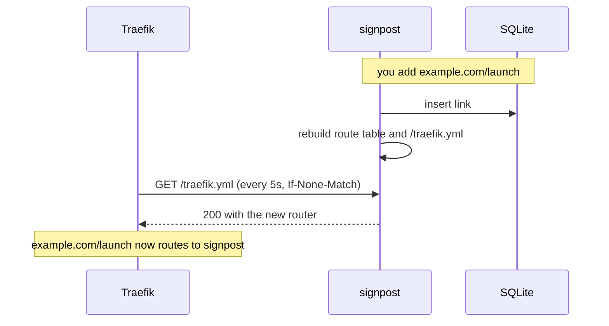
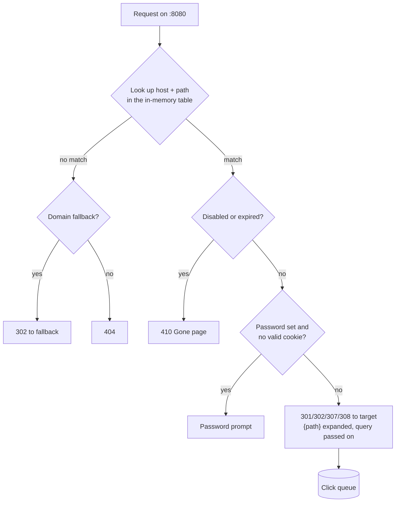

# How it works

signpost is one Go process with one SQLite file. It does three jobs: it tells
Traefik which exact paths to send it, it answers those requests with
redirects, and it gives you a dashboard and API to manage the links.

- [Routing](#routing)
- [The redirect path](#the-redirect-path)
- [Recording clicks](#recording-clicks)
- [Verification](#verification)
- [Analytics and privacy](#analytics-and-privacy)
- [Password-protected links](#password-protected-links)
- [Design decisions](#design-decisions)

## Routing



Every link becomes a Traefik router that matches one host and one path, at a
priority far above anything Docker labels produce:

```yaml
http:
  routers:
    signpost-link-1:
      rule: Host(`milind.dev`) && (Path(`/helloworld`) || Path(`/helloworld/`))
      priority: 10000
      service: signpost
      entryPoints: [websecure]
      tls: {}
  services:
    signpost:
      loadBalancer:
        servers:
          - url: http://signpost:8080
```

Traefik reads this from `GET /traefik.yml` through its HTTP provider, or from
a file signpost writes atomically for the file provider. The configuration is
a pure function of the database and is rebuilt whole on every change. It
carries an ETag, so the steady-state poll is a `304` with no body.

A host with a `/*` link gets a single router for the whole host, and signpost
chooses between its exact links and `/*` in memory, so a host signpost owns
outright costs one router however many links it has. The full router table is
in [configuration.md](configuration.md#routes-and-priorities).

## The redirect path



The route table is an immutable map from host and path to a small struct,
held behind an `atomic.Pointer`. A redirect loads the pointer, does one map
lookup, writes the response and puts the click on a channel. It never
touches the database, never takes a lock and never waits for anything.

The table is rebuilt and swapped in whole:

- immediately, after any change made through signpost;
- within 2 seconds of a change made to the database by anything else, which
  signpost notices through `PRAGMA data_version`;
- every 5 minutes regardless, as a backstop.

Click counts are deliberately not in the table, so the table never goes stale
as traffic arrives and never needs rebuilding because of it.

## Recording clicks

Clicks go onto a buffered queue of 4,096. One writer drains it and commits a
batch every second, or as soon as 500 are waiting, in a single transaction.
One fsync per batch instead of one per click makes each click about 20 times
cheaper to store (6.8 µs against 145 µs in the benchmark), so a burst of
traffic never queues behind the disk.

If the queue is ever full, the click is dropped rather than slowing the
redirect, and the number dropped is logged once a minute. On shutdown the
queue is drained before the process exits.

## Verification

signpost never assumes a link works. It checks twice.

**Before creating a link,** it fetches the path from the public internet. If
anything other than a 404 answers, it refuses, because something already
lives there. For a `/*` link it checks the root of the host. Forcing it is a
deliberate choice, in the dashboard or with `-force`.

**After creating a link,** it probes the link until it answers with the right
redirect and the header `X-Signpost-Link: <id>`, which proves the answer came
from signpost and not something else on the way. It retries for about five
minutes, since a new hostname may need a certificate, then settles on:

| State | Meaning |
|---|---|
| Live | Answers publicly, from signpost, with the right status. |
| DNS issue | Answers through Traefik directly, but not over the public internet. Needs `SIGNPOST_PROBE_ADDR`. |
| Error | Does not answer correctly, with the reason. |

Probes carry a secret header so signpost recognises its own requests: they
always get the plain redirect and are never counted as clicks.

**Domains** get a DNS check when connected and every 6 hours after. signpost
reads the A and AAAA records from 1.1.1.1 and classifies them as pointing
here (compared with `SIGNPOST_PUBLIC_IPS`), proxied by Cloudflare, somewhere
else, or missing. A record proxied by Cloudflare never shows your server's
address, so the check then proves the round trip instead: it fetches a secret
token from `https://<host>/.well-known/signpost/<token>`, which only this
signpost can answer.

## Analytics and privacy

Each click stores the time, the referrer, the country and city, the parsed user agent
(device, browser, operating system) and a visitor pseudonym. It does not
store the IP address.

The pseudonym is an HMAC of the date, the IP and the user agent under a
server-side secret. The same visitor on the same day hashes the same, so
unique visitors can be counted. The next day the hash is different, so nobody
can be followed across days, and the IP cannot be recovered from it.

Country comes from Cloudflare's `CF-IPCountry` header when your domain is
proxied by Cloudflare, and city from `CF-IPCity` if Cloudflare's "Add
visitor location headers" managed transform is on. Otherwise, or when
Cloudflare reports `XX` (unknown), signpost looks the IP up in a
MaxMind-format database on disk (`SIGNPOST_GEOIP_DB`). The image ships
[DB-IP's free city database](https://db-ip.com/db/download/ip-to-city-lite),
which CI refreshes monthly. When Cloudflare gave the country but no city,
the database's city is used only if it agrees on the country. The lookup
happens in the process, nothing is sent anywhere, and only the two-letter
country code and the city name are kept. Without a database, clicks on
domains that are not proxied are recorded with no location.

City data from a free IP database is approximate. Mobile networks in
particular often route through a gateway in a bigger city, so a click from
Pune may be counted in Mumbai. DB-IP sometimes names a neighbourhood
("Navi Mumbai (Ghansoli)"); signpost keeps only the city so clicks group
together. Clicks recorded before city lookups existed have no city.

The Analytics page draws countries on a world map (Natural Earth's
1:50m country shapes, generated into `web/world.txt` by `tools/worldmap`),
shaded on a log scale so one busy country does not wash out the rest. Beside
it, a switch shows the top countries or the top cities, each city counted
with its country so places that share a name stay apart.

Link previews and crawlers (Slack, WhatsApp, Discord, facebookexternalhit,
Twitterbot, Googlebot, curl and many more) are recorded but excluded from
counts, so pasting a link into a chat does not inflate it. The dashboard shows
how many were filtered.

Charts are bucketed in the viewer's time zone, taken from the browser.

## Password-protected links

A protected link answers with a password prompt instead of a redirect.
Passwords are stored as PBKDF2-SHA256 at 600,000 iterations (OWASP's current
recommendation), with a random salt, using only the Go standard library.
Wrong attempts are rate limited per IP and link. A correct password sets a
cookie scoped to that link for 24 hours; changing the password invalidates
every cookie issued for the old one. Only visits that get through are counted
as clicks.

## Design decisions

### Why not a Traefik plugin?

Plugins are middlewares. Catching bare paths would mean hanging one on the
entrypoint, which runs interpreted Go (Yaegi) on every request to every
service on the server. Plugins also need a public repository, vendored
dependencies and a Traefik restart on every change, and there is nowhere for
a dashboard or a database to live. A bug in a plugin is an outage for
everything behind Traefik; a bug in signpost is an outage for short links.

### Why not Traefik's API?

It is read-only. It reports routers but cannot create them.

### Why not Docker labels?

Labels are fixed when a container is created, so every new link would mean
recreating a container, and signpost would need the Docker socket.

### Why SQLite?

Links are read from memory, so the database only sees writes: link changes,
which are rare, and clicks, which are batched. One file is trivial to back up
and move, needs no separate service, and the pure-Go driver keeps the binary
static, so the image can be `FROM scratch`.

### Why server-rendered HTML?

The dashboard is Go templates and htmx, with Tailwind and a little TypeScript
compiled at build time and embedded in the binary. There is no client-side
framework, no CDN and nothing to install, and every page works on a phone.
